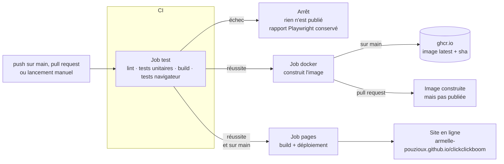

# Le CI/CD de Click Click Boom

Ce document explique comment le projet est testé, empaqueté et mis en ligne automatiquement à chaque modification.
Tout est décrit dans un seul fichier : [`.github/workflows/ci-cd.yml`](../.github/workflows/ci-cd.yml).

---

## 1. L'idée en une phrase

À chaque fois que du code arrive sur GitHub, une machine vérifie qu'il fonctionne
(**CI**, intégration continue) ; si c'est le cas et que le code est sur la branche `main`,
elle construit une image Docker et met le jeu en ligne sur GitHub Pages (**CD**, déploiement continu).

Un code qui casse un test **n'est jamais mis en ligne**.

---

## 2. Le vocabulaire

| Terme | Ce que c'est, dans ce projet |
|---|---|
| **CI** (*Continuous Integration*) | Vérifier automatiquement chaque modification : lint, tests, build. |
| **CD** (*Continuous Deployment*) | Publier automatiquement ce qui a passé la CI : image Docker et site en ligne. |
| **GitHub Actions** | Le service de GitHub qui exécute les workflows. |
| **Workflow** | Un fichier YAML dans `.github/workflows/`. Ici : `ci-cd.yml`. |
| **Événement** (*trigger*) | Ce qui déclenche le workflow : un push, une pull request, un clic manuel. |
| **Job** | Un groupe d'étapes exécuté sur une machine. Ici : `test`, `docker`, `pages`. |
| **Step** (étape) | Une commande (`npm test`) ou une *action* toute faite. |
| **Action** | Un module réutilisable publié par GitHub ou la communauté (`actions/checkout`, `docker/build-push-action`…). |
| **Runner** | La machine virtuelle qui exécute un job. Ici `ubuntu-latest` : une machine Linux neuve, fournie par GitHub, détruite à la fin. |
| **Artefact** | Un fichier produit par un job et conservé : le rapport des tests, le site à déployer. |
| **Registre** (*registry*) | Un serveur qui stocke des images Docker. Ici le GitHub Container Registry, `ghcr.io`. |
| **`GITHUB_TOKEN`** | Un jeton d'accès créé automatiquement par GitHub pour chaque exécution, puis détruit. |

---

## 3. Le schéma



Les jobs `docker` et `pages` attendent tous les deux la réussite de `test` (`needs: test`),
puis s'exécutent **en parallèle**.

---

## 4. Quand le workflow se déclenche

```yaml
on:
  push:
    branches: [main]
  pull_request:
  workflow_dispatch:
```

| Événement | Ce qui tourne |
|---|---|
| **Push sur `main`** | Les 3 jobs : tests, image Docker **publiée**, site **déployé**. |
| **Pull request** (vers n'importe quelle branche) | Tests + image Docker **construite mais pas publiée**. Pas de déploiement. |
| **Lancement manuel** (`workflow_dispatch`) | Bouton *Run workflow* dans l'onglet Actions. Sur `main`, fait exactement comme un push : tests, publication de l'image, déploiement. Seules les personnes ayant le droit d'écrire dans le dépôt voient ce bouton. |

Un push sur une autre branche que `main`, sans pull request, ne déclenche rien.

### Annulation des exécutions dépassées

```yaml
concurrency:
  group: ${{ github.workflow }}-${{ github.ref }}
  cancel-in-progress: true
```

Si on pousse deux fois de suite sur la même branche, l'exécution du premier push est annulée :
seul le code le plus récent compte. On ne gaspille pas de minutes de calcul, et deux déploiements
ne peuvent pas se marcher dessus.

---

## 5. Job 1 : `test`, la vérification (CI)

C'est le gardien : si une seule étape échoue, le job échoue et **rien n'est publié**.

| # | Étape | Ce qu'elle fait | Pourquoi |
|---|---|---|---|
| 1 | `actions/checkout@v4` | Récupère le code du commit sur la machine. | La machine part de zéro. |
| 2 | `actions/setup-node@v4` (Node 22, cache npm) | Installe Node.js et réutilise les paquets téléchargés lors des exécutions précédentes. | Le cache accélère l'installation. |
| 3 | `npm ci` | Installe **exactement** les versions inscrites dans `package-lock.json`. | Contrairement à `npm install`, ne modifie jamais le lock : la CI teste les mêmes versions que sur ton PC. |
| 4 | `npm run lint` | ESLint analyse le code. | Détecte les erreurs avant l'exécution : variable inutilisée ou non définie, code mort… |
| 5 | `npm test` | Lance les **60 tests unitaires** Vitest. | Vérifie les règles du jeu (détail plus bas). |
| 6 | `npm run build` | Vite construit le site dans `dist/`. | Vérifie que le site se construit. |
| 7 | Tests de bout en bout | `npx playwright install --with-deps chromium` puis `npm run test:e2e`. | Joue au jeu dans un vrai navigateur (détail plus bas). |
| 8 | Rapport Playwright (`if: failure()`) | Uniquement en cas d'échec : enregistre le rapport HTML comme artefact pendant 7 jours. | Permet de voir **quel** test a échoué, avec la trace du navigateur. |

### Ce que vérifient les 60 tests unitaires (Vitest)

Ils tournent sans navigateur, en moins de 2 secondes. C'est possible parce que la logique du jeu
(`src/game/`) est séparée de l'affichage (`src/ui/`) et ne touche jamais au DOM.

| Fichier | Tests | Ce qui est vérifié |
|---|---|---|
| `economy.test.js` | 16 | Coûts (un lot de 10 recruteurs = la somme des prix un par un), production, bonus des paliers, protection, répression, force du mouvement. |
| `engine.test.js` | 15 | Actions du joueur (clic, achats refusés si trop chers), seconde de jeu, game over à 100 % de répression, malus et leur délai, paliers, sauvegarde et rechargement. |
| `events.test.js` | 10 | Effets des événements (un gain ne dépasse jamais 95 % de répression), paris, décisions. |
| `grandSoir.test.js` | 7 | Calcul des chances (plafond à 90 %), déblocage, échec (−50 %, attente), victoire, rejouer. |
| `saves.test.js` | 4 | Création et suppression de parties, séparation des données, migration des anciennes sauvegardes. |
| `balance.test.js` | 8 | **Équilibrage** : 6 parties complètes jouées par un joueur virtuel doivent être gagnées en 5 à 20 minutes sans game over ; le Grand Soir doit parfois demander plusieurs tentatives ; un joueur qui n'achète rien doit perdre. |

Les parties simulées utilisent un hasard **déterministe** (une graine fixe) : chaque exécution rejoue
exactement les mêmes parties. Un test qui échoue échoue donc toujours, ce qui permet de reproduire le problème.

### Ce que vérifient les tests de bout en bout (Playwright)

14 scénarios, exécutés **deux fois** : sur un écran d'ordinateur (*Desktop Chrome*) et sur un téléphone
(*Pixel 7*), soit **28 exécutions**. Ils tournent sur le **site construit** (`vite preview`),
c'est-à-dire exactement ce qui sera mis en ligne.

| Fichier | Scénarios |
|---|---|
| `launcher.spec.js` (4) | Créer une partie (y compris en cliquant sur le nom du chef), revenir à l'accueil, supprimer une partie, rediriger une partie inconnue, pas de défilement horizontal. |
| `game.spec.js` (8) | Clics, achat de recruteurs par lot, bonus cliquable seulement s'il est abordable, sauvegarde après rechargement, statistiques, bulle du chef, aide, pas de défilement horizontal. |
| `grand-soir.spec.js` (2) | Insurrection ratée puis réussie, puis rejouer ; une décision met bien le jeu en pause. |

Pour rendre le hasard prévisible, le test remplace `Math.random` **avant** le chargement de la page,
par une fonction qui renvoie la valeur choisie par le test (échec forcé, puis réussite forcée).

Réglages spécifiques à la CI dans [`playwright.config.js`](../playwright.config.js) :
- `forbidOnly` : refuse un test oublié avec `.only`, qui ferait sauter tous les autres en silence ;
- `retries: 1` : relance une fois un test qui échoue, pour absorber une lenteur passagère de la machine ;
- `reducedMotion: "reduce"` : coupe les animations pour que les clics soient fiables.

---

## 6. Job 2 : `docker`, l'image (CD)

```yaml
needs: test
permissions:
  contents: read
  packages: write
```

Il ne démarre que si `test` a réussi, et n'a que les droits nécessaires : lire le code et écrire dans le registre.

| # | Étape | Ce qu'elle fait |
|---|---|---|
| 1 | `actions/checkout@v4` | Récupère le code. |
| 2 | `docker/setup-buildx-action@v3` | Prépare *Buildx*, le moteur de construction de Docker (nécessaire pour le cache). |
| 3 | `docker/login-action@v3` (**seulement sur `main`**, jamais pour une pull request) | Se connecte à `ghcr.io` avec le `GITHUB_TOKEN`. |
| 4 | `docker/metadata-action@v5` | Calcule le nom et les étiquettes (*tags*) de l'image. |
| 5 | `docker/build-push-action@v6` | Construit l'image ; la **publie** seulement sur `main`. |

### Les étiquettes de l'image

Nom : `ghcr.io/armelle-pouzioux/clickclickboom`

| Étiquette | Exemple | Rôle |
|---|---|---|
| `latest` | `…/clickclickboom:latest` | Toujours la dernière version de `main`. |
| `sha-<commit>` | `…/clickclickboom:sha-252d2f0` | Une version **précise** et définitive, liée à un commit. On peut revenir à n'importe quelle version passée. |

### Pourquoi construire l'image même sur une pull request ?

Pour vérifier que le `Dockerfile` fonctionne **avant** de fusionner. L'image est construite puis jetée :
une pull request ne peut rien publier.

### Le cache

`cache-from: type=gha` et `cache-to: type=gha,mode=max` stockent les couches de l'image dans le cache
de GitHub Actions. Si `package.json` n'a pas changé, l'étape `npm ci` n'est pas refaite.

### Le `Dockerfile` : une construction en deux étapes (*multi-stage*)

```dockerfile
FROM node:22-alpine AS build      # étape 1 : construire
WORKDIR /app
COPY package.json package-lock.json ./
RUN npm ci                        # copié AVANT le reste du code : le cache
COPY . .                          # n'est invalidé que si les dépendances changent
RUN npm run build

FROM nginx:1.29-alpine            # étape 2 : servir
COPY nginx.conf /etc/nginx/conf.d/default.conf
COPY --from=build /app/dist /usr/share/nginx/html
```

- **Étape 1** : une image Node construit le site.
- **Étape 2** : on repart d'une image nginx vide et on n'y copie **que** le dossier `dist/`.

L'image finale ne contient ni Node.js, ni `node_modules`, ni le code source : elle est légère et
expose moins de surface d'attaque.

Le fichier `.dockerignore` évite d'envoyer à Docker ce qui ne sert pas au build :
`node_modules`, `.git`, les tests, les images non utilisées…

### `nginx.conf` : le serveur web

| Règle | Effet |
|---|---|
| `gzip on` | Compresse CSS, JS et JSON avant de les envoyer. |
| `/assets/` → `Cache-Control: public, immutable`, 1 an | Vite met une empreinte dans le nom de ces fichiers (`game-D0pJlj3f.js`) : si le contenu change, le nom change, on peut donc les garder en cache indéfiniment. |
| `*.html` → `no-cache` | Les pages sont toujours revérifiées : le joueur reçoit la nouvelle version tout de suite. |
| `HEALTHCHECK` (dans le Dockerfile) | Docker vérifie toutes les 30 s que le serveur répond. |

Lancer l'image publiée :

```bash
docker run --rm -p 8080:80 ghcr.io/armelle-pouzioux/clickclickboom:latest
# puis ouvrir http://localhost:8080
```

---

## 7. Job 3 : `pages`, la mise en ligne (CD)

```yaml
needs: test
if: github.event_name != 'pull_request' && github.ref == 'refs/heads/main'
permissions:
  contents: read
  pages: write
  id-token: write
environment:
  name: github-pages
```

- `needs` + `if` : seulement après des tests réussis, seulement sur `main`, et jamais pour une pull request.
- `pages: write` : droit de publier sur GitHub Pages.
- `id-token: write` : GitHub Pages vérifie, par un jeton signé (OIDC), que le déploiement vient bien
  de ce workflow et de ce dépôt.
- `environment: github-pages` : chaque déploiement est historisé dans l'onglet **Environments** du dépôt,
  avec le lien du site.

| # | Étape | Ce qu'elle fait |
|---|---|---|
| 1-4 | checkout, setup-node, `npm ci`, `npm run build` | Construit le site dans `dist/`. |
| 5 | `actions/configure-pages@v5` | Vérifie que Pages est activé et récupère sa configuration. |
| 6 | `actions/upload-pages-artifact@v3` | Empaquette `dist/` comme artefact. |
| 7 | `actions/deploy-pages@v4` | Publie l'artefact. L'adresse du site est affichée dans le résumé du run. |

Adresse : **https://armelle-pouzioux.github.io/clickclickboom/**

### Pourquoi `base: "./"` dans `vite.config.js` ?

GitHub Pages sert le site dans un **sous-dossier** (`/clickclickboom/`), pas à la racine du domaine.
Avec des chemins relatifs (`./assets/…` au lieu de `/assets/…`), le même build fonctionne
sur GitHub Pages, dans l'image Docker (servie à la racine) et en local.

---

## 8. La sécurité

| Choix | Pourquoi |
|---|---|
| **Aucun secret à configurer** | Tout passe par le `GITHUB_TOKEN`, créé pour chaque exécution puis détruit. Aucun mot de passe n'est stocké dans le dépôt ni dans les réglages. |
| **Permissions minimales** | Par défaut `contents: read` (lecture seule). Seul `docker` peut écrire dans le registre, seul `pages` peut publier le site. |
| **Rien n'est publié depuis une pull request** | La connexion au registre et le déploiement exigent d'être sur `main` et que l'événement ne soit pas une pull request. Une contribution extérieure ne peut pas mettre en ligne du code non relu. |
| **Publication après les tests** | `needs: test` : un code cassé ne part jamais en ligne. |
| **Versions figées** | `npm ci` + `package-lock.json` côté code ; versions majeures fixées pour les actions (`@v4`…) et les images Docker (`node:22`, `nginx:1.29`). |

---

## 9. Trois scénarios concrets

### A. Je pousse une modification correcte sur `main`
1. `test` passe (lint, 60 tests, build, 28 exécutions Playwright).
2. `docker` et `pages` démarrent en parallèle.
3. Résultat : nouvelle image `latest` + `sha-…` sur `ghcr.io`, et le site en ligne est mis à jour.

### B. J'ouvre une pull request qui casse une règle du jeu
Par exemple, je change `failLoss` à 100 % dans `config.js` sans mettre à jour les tests.
1. `test` échoue à l'étape `npm test` : le test du Grand Soir attend une perte de 50 %.
2. `docker` ne démarre pas (`needs: test`) ; `pages` ne tourne jamais sur une pull request.
3. GitHub affiche une croix rouge sur la pull request : on voit qu'il ne faut pas fusionner.

### C. Un test navigateur échoue
1. Playwright relance le test une fois (`retries: 1`).
2. S'il échoue encore, le rapport HTML est conservé comme artefact pendant 7 jours :
   onglet **Actions** → le run → **Artifacts** → `playwright-report`.

---

## 10. Faire la démonstration en soutenance

1. **Onglet Actions** du dépôt : la liste des exécutions, chacune liée à un commit.
2. Ouvrir une exécution : les 3 jobs, leur durée, et le détail de chaque étape (journaux).
3. **Relancer à la main** : bouton *Run workflow* (grâce à `workflow_dispatch`).
4. **Le site** : https://armelle-pouzioux.github.io/clickclickboom/
5. **L'image** : onglet **Packages** du profil, avec les étiquettes `latest` et `sha-…`.
6. **Démo d'échec** (si le temps le permet) : sur une branche, casser un test, ouvrir une pull request,
   montrer la croix rouge et le job `docker` qui ne démarre pas.

En local, la même vérification que la CI :

```bash
npm run check   # lint + tests unitaires + build + tests de bout en bout
```

---

## 11. Limites et améliorations possibles

Points d'amélioration, à mentionner si le jury pose la question :

- **Le site est construit deux fois** (dans `test` et dans `pages`). On pourrait transmettre le `dist/`
  du job `test` comme artefact pour le réutiliser.
- **L'image Docker n'est pas testée après sa construction** : on pourrait démarrer le conteneur dans la CI
  et vérifier qu'il répond (`curl`), ou y lancer les tests Playwright.
- **Pas de numéros de version** : on pourrait publier des versions (`v1.0.0`) à partir des tags Git,
  avec des notes de version.
- **Protection de la branche `main`** : rendre la réussite de la CI obligatoire avant toute fusion
  (*Settings → Branches → Branch protection rules*).
- **Mises à jour des dépendances** : activer Dependabot pour recevoir automatiquement des pull requests
  de mise à jour, testées par la CI.
- **Pas d'environnement de préproduction** : chaque push sur `main` part directement en production.

---

## 12. Questions probables du jury

**Pourquoi GitHub Actions plutôt que GitLab CI, Jenkins… ?**
Le code est déjà sur GitHub : pas de serveur à installer ni à maintenir, l'intégration avec les pull requests,
le registre `ghcr.io` et GitHub Pages est native, et c'est gratuit pour un dépôt public.

**Pourquoi Docker si le site est déjà sur GitHub Pages ?**
Pages sert à la mise en ligne publique. L'image Docker rend le jeu déployable n'importe où
(un serveur, un cloud, le PC d'un collègue) avec une seule commande, toujours dans le même environnement.

**Quelle différence entre `npm install` et `npm ci` ?**
`npm ci` installe exactement ce qui est inscrit dans `package-lock.json`, efface `node_modules` avant,
et échoue si le lock ne correspond pas à `package.json`. C'est reproductible, donc adapté à la CI.

**Comment tester un jeu basé sur le hasard ?**
La logique reçoit sa fonction de hasard en paramètre. Les tests unitaires lui passent un générateur à graine fixe,
les tests navigateur remplacent `Math.random` avant le chargement de la page. Les résultats sont donc reproductibles.

**Que se passe-t-il si deux personnes poussent en même temps ?**
Chaque push lance son exécution. Sur une même branche, `concurrency` annule l'exécution la plus ancienne :
seul le dernier code est testé et déployé.

**Où sont stockés les mots de passe ?**
Nulle part : le `GITHUB_TOKEN` est généré par GitHub pour chaque exécution, avec uniquement les droits déclarés
dans le workflow, et il expire à la fin.

**Comment revenir à une version précédente ?**
Pour l'image : lancer l'étiquette `sha-<commit>` voulue. Pour le site : annuler le commit fautif
(`git revert`) et pousser ; la CI redéploie l'ancienne version.
